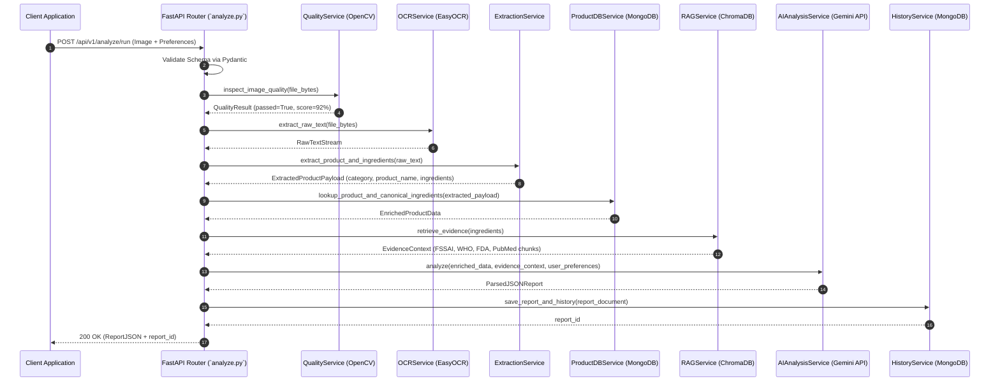

# PARAKH — Backend Architecture

## Executive Overview
The PARAKH backend is designed as a **FastAPI Modular Monolithic Backend** in Python 3.11. It organizes application features into cohesive internal modules (`services/`, `routers/`, `schemas/`, `db/`) running in a single application process, eliminating microservices networking overhead while maintaining clear code separation.

---

## 1. Backend Directory Structure

```
backend/
├── app/
│   ├── main.py                  # FastAPI application entry point, CORS & middleware
│   ├── config.py                # Environment settings (.env parser via pydantic-settings)
│   ├── api/
│   │   ├── v1/
│   │   │   ├── api.py           # Master Router aggregating sub-routers
│   │   │   ├── endpoints/
│   │   │   │   ├── analyze.py   # Upload, quality-check, run endpoints
│   │   │   │   ├── report.py    # Report retrieval endpoints (PDF optional)
│   │   │   │   ├── ingredient.py# Ingredient detail query endpoints
│   │   │   │   ├── preference.py# User preferences CRUD endpoints
│   │   │   │   └── history.py   # Analysis history endpoints
│   ├── core/
│   │   ├── exceptions.py        # Custom exception classes & error handlers
│   │   └── logging.py           # Structured JSON logger setup
│   ├── schemas/                 # Pydantic validation models
│   │   ├── quality.py           # Quality check payload & response schemas
│   │   ├── analysis.py          # Analysis request & JSON contract output schemas
│   │   ├── ingredient.py        # Ingredient schema models
│   │   ├── preference.py        # User preference schemas
│   │   └── report.py            # Transparency report schemas
│   ├── services/                # Core business logic modules
│   │   ├── quality_service.py   # OpenCV image quality validation
│   │   ├── ocr_service.py       # OCR text extraction engine
│   │   ├── extraction_service.py# Category-aware product & ingredient extractor
│   │   ├── product_db_service.py# Product DB & canonical registry lookup
│   │   ├── rag_service.py       # ChromaDB semantic query & context assembly
│   │   ├── ai_analysis_service.py# Gemini API analysis & personalization engine
│   │   └── pdf_service.py       # [Optional] PDF report generator
│   ├── db/
│   │   ├── mongo.py             # Motor async MongoDB connection pool
│   │   ├── vector_store.py      # ChromaDB client initialization
│   │   └── models.py            # PyMongo document abstractions
│   └── utils/
│       ├── image_utils.py       # Image resizing, cropping, & format conversion
│       └── text_utils.py        # String sanitization & delimiter parsing
├── data/
│   ├── kb_documents/            # PDF/JSON source documents (FSSAI, WHO, FDA, PubMed)
│   └── dictionaries/            # Canonical ingredient dictionaries (Skincare, Food, Supplements)
├── tests/
│   ├── test_quality.py          # Unit tests for image quality calculations
│   ├── test_ocr.py              # Unit tests for OCR text extraction
│   ├── test_extraction.py       # Unit tests for category-aware parsing
│   ├── test_rag.py              # Unit tests for vector search retrieval
│   └── test_api.py              # Integration tests for FastAPI endpoints
├── .env.example                 # Environment variables template
├── Dockerfile                   # Deployment container
└── requirements.txt             # Python dependencies manifest
```

---

## 2. API Request / Response Execution Pipeline



---

## 3. Key Backend Services Specification

### Service 1: `QualityService` (`services/quality_service.py`)
- **Input:** Image byte stream (`bytes`).
- **Processing:** Laplacian blur test, brightness histogram evaluation, bounding box ratio detection.
- **Output:** `QualityResult` (Pass/Fail status, numerical score, diagnostic flags).

### Service 2: `OCRService` (`services/ocr_service.py`)
- **Input:** Validated image bytes.
- **Processing:** Image binarization, EasyOCR/Tesseract character extraction.
- **Output:** Raw text stream.

### Service 3: `ExtractionService` (`services/extraction_service.py`)
- **Input:** Raw OCR text stream.
- **Processing:** Category-aware parsing across Skincare (INCI), Food (FSSAI/Additives), and Dietary Supplements; delimiter splitting; RapidFuzz canonical ingredient dictionary matching.
- **Output:** `ExtractedProductPayload` (Detected Category, Product Name, Canonical Ingredient List).

### Service 4: `ProductDBService` (`services/product_db_service.py`)
- **Input:** `ExtractedProductPayload`.
- **Processing:** MongoDB lookup for existing verified product records and canonical ingredient definitions.
- **Output:** Enriched product and ingredient metadata object.

### Service 5: `RAGService` (`services/rag_service.py`)
- **Input:** Normalized ingredient names.
- **Processing:** Embed query strings (`all-MiniLM-L6-v2`); search local ChromaDB vector store; filter top-k chunks by similarity threshold $\ge 0.65$.
- **Output:** `EvidenceContext` object with citations and authority weights (FSSAI, WHO, FDA, PubMed).

### Service 6: `AIAnalysisService` (`services/ai_analysis_service.py`)
- **Input:** Enriched Product Data + Evidence Context + User Preferences.
- **Processing:** Single-stage LLM call (Google Gemini API) with structured JSON enforcement (`response_mime_type="application/json"`). Evaluates user preference matching directly in prompt.
- **Output:** Validated JSON transparency report object.

---

## 4. Error Handling & Validation Policy

- **Input Validation:** Pydantic v2 schemas validate all payload inputs.
- **Global Error Middleware:** Unhandled server exceptions are caught gracefully, logging internal traces and returning a standardized JSON error response.
