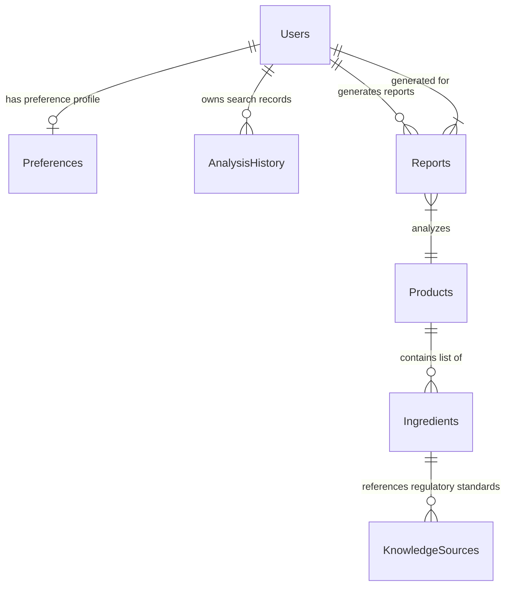

# PARAKH — Database Schema Design

## Executive Overview
PARAKH uses **MongoDB** as its operational document store due to the semi-structured nature of multi-domain product labels (skincare, foods, supplements), nested ingredient trees, dynamic user preference profiles, and JSON transparency reports.

---

## 1. Database Entity Relationship Diagram (MongoDB Collections)



---

## 2. Collection Schemas

### 1. Collection: `users`
Stores registered or anonymous session user accounts.

```json
{
  "_id": "ObjectId('66e85a1f2b3c4d5e6f7a8b9c')",
  "user_id": "USR-882910",
  "created_at": "2026-09-16T18:10:51Z",
  "last_active": "2026-09-16T18:10:51Z",
  "is_anonymous": true
}
```
- **Indexes:** `user_id` (Unique)

---

### 2. Collection: `preferences`
Stores user health goals, dietary preferences, and ingredient sensitivities.

```json
{
  "_id": "ObjectId('66e85a1f2b3c4d5e6f7a8b9d')",
  "user_id": "USR-882910",
  "sensitivities": [
    "fragrance",
    "essential_oils",
    "parabens",
    "sulfates"
  ],
  "dietary_preferences": [
    "vegan",
    "gluten_free",
    "cruelty_free"
  ],
  "health_goals": [
    "sensitive_skin",
    "low_sodium",
    "diabetic_friendly"
  ],
  "updated_at": "2026-09-16T18:10:51Z"
}
```
- **Indexes:** `user_id` (Unique)

---

### 3. Collection: `products`
Stores product records across skincare, food, and supplement domains.

```json
{
  "_id": "ObjectId('66e85a1f2b3c4d5e6f7a8b9e')",
  "product_id": "PRD-VB-882",
  "barcode": "8901234567890",
  "brand_name": "Verdant Botanicals Ltd.",
  "product_name": "Verdant Botanicals Serum",
  "domain_category": "Skincare",
  "batch_number": "VB-882",
  "raw_ocr_text": "Ingredients: Water, Niacinamide, Glycerin, Phenoxyethanol, Fragrance",
  "extracted_ingredients": [
    "water",
    "niacinamide",
    "glycerin",
    "phenoxyethanol",
    "fragrance"
  ],
  "image_url": "/uploads/products/verdant_botanicals_label_01.jpg",
  "created_at": "2026-09-16T18:10:51Z"
}
```
- **Indexes:**
  - `product_id` (Unique)
  - `barcode` (Sparse Index for optional barcode lookup)
  - `product_name` (Text Index)

---

### 4. Collection: `ingredients`
Stores multi-domain canonical ingredient definitions.

```json
{
  "_id": "ObjectId('66e85a1f2b3c4d5e6f7a8b9f')",
  "ingredient_id": "ING-NIACINAMIDE",
  "canonical_name": "Niacinamide",
  "domain_categories": ["Skincare", "Dietary Supplements"],
  "inci_name": "NIACINAMIDE",
  "aliases": ["Vitamin B3", "Nicotinamide", "3-Pyridinecarboxamide"],
  "primary_function": "Skin conditioning, barrier repair, vitamin supplementation",
  "default_safety_class": "BENEFICIAL",
  "regulatory_status": {
    "fssai_status": "Permitted dietary additive",
    "who_status": "Permitted active compound",
    "fda_status": "GRAS / Safe in cosmetics up to 5%"
  },
  "updated_at": "2026-09-16T18:10:51Z"
}
```
- **Indexes:**
  - `canonical_name` (Unique)
  - `aliases` (Multikey Index for fuzzy matching)

---

### 5. Collection: `knowledge_sources`
Tracks imported regulatory documents and research papers indexed in ChromaDB vector store.

```json
{
  "_id": "ObjectId('66e85a1f2b3c4d5e6f7a8ba0')",
  "source_id": "KS-FSSAI-2022-SEC4",
  "authority_level": "FSSAI",
  "title": "FSSAI Food Safety and Standards Regulations 2022",
  "section": "Section 4.1: Ingredient List & Additive Requirements",
  "publication_year": 2022,
  "url": "https://www.fssai.gov.in/regulations/2022.pdf",
  "created_at": "2026-09-16T18:10:51Z"
}
```
- **Indexes:** `source_id` (Unique)

---

### 6. Collection: `reports`
Stores synthesized AI transparency reports.

```json
{
  "_id": "ObjectId('66e85a1f2b3c4d5e6f7a8ba1')",
  "report_id": "REP-992182",
  "user_id": "USR-882910",
  "product_id": "PRD-VB-882",
  "analysis_timestamp": "2026-09-16T18:10:51Z",
  "metrics": {
    "ingredients_detected_count": 5,
    "confidence_score": 94,
    "evidence_sources_count": 3,
    "verification_status": "LABEL_VERIFIED"
  },
  "ingredient_breakdown": {
    "beneficial": [
      {
        "name": "Niacinamide",
        "function": "Barrier Repair",
        "evidence_tag": "FSSAI / FDA"
      }
    ],
    "sensitivities": [
      {
        "name": "Fragrance",
        "concern": "Potential skin irritant for sensitive profiles",
        "evidence_tag": "WHO / FDA Directive"
      }
    ],
    "additives": [
      {
        "name": "Phenoxyethanol",
        "purpose": "Preservative (<1% limit)",
        "evidence_tag": "FDA Cosmetics Standard"
      }
    ]
  },
  "personalized_insights": [
    {
      "type": "WARNING",
      "preference_matched": "fragrance",
      "message": "Product contains synthetic fragrance, matching your sensitive skin setting."
    }
  ],
  "evidence_citations": [
    {
      "source_name": "FSSAI Guidelines 2022",
      "quote": "Preservative concentrations must be disclosed if exceeding threshold limits.",
      "authority": "FSSAI"
    }
  ],
  "uncertainty_declaration": "No evidence of heavy metals detected, but batch certificate verification is recommended.",
  "disclaimer": "PARAKH provides informational product intelligence based on available public guidelines. It is not a medical diagnosis or treatment system."
}
```
- **Indexes:** `report_id` (Unique), `user_id` + `analysis_timestamp` (Compound Index)

---

### 7. Collection: `analysis_history`
Stores lightweight summary items for rendering the `/history` screen efficiently.

```json
{
  "_id": "ObjectId('66e85a1f2b3c4d5e6f7a8ba2')",
  "history_id": "HIST-5521",
  "user_id": "USR-882910",
  "report_id": "REP-992182",
  "product_name": "Verdant Botanicals Serum",
  "category": "Skincare",
  "confidence_score": 94,
  "flagged_ingredients_count": 1,
  "thumbnail_url": "/uploads/products/verdant_thumb.jpg",
  "analyzed_at": "2026-09-16T18:10:51Z"
}
```
- **Indexes:** `user_id` + `analyzed_at` (Descending Index)
