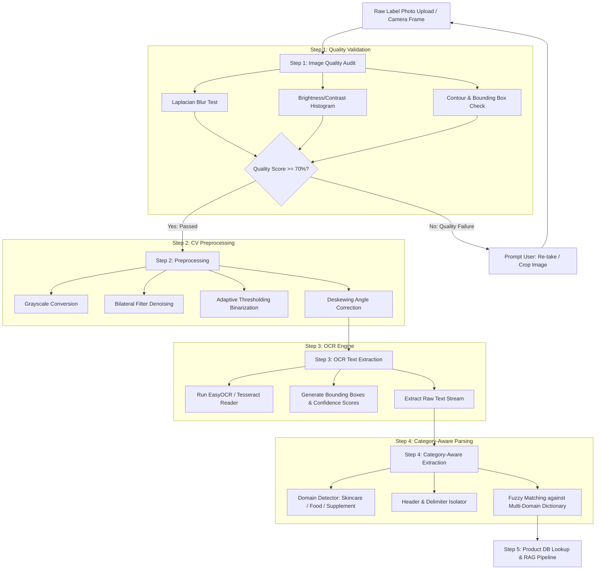

# PARAKH — OCR + Computer Vision Pipeline

## Executive Overview
The Computer Vision & OCR pipeline transforms raw consumer product label photos into clean raw text streams. The extracted text is then passed to the **Category-Aware Product & Ingredient Extraction Layer**, which parses ingredients across skincare, food, and supplement domains.

---

## 1. Complete End-to-End Vision & Extraction Flow



---

## 2. Image Quality Verification Math & Logic

The Quality Audit runs in OpenCV (`cv2`) before any heavy downstream backend operations.

### 1. Sharpness & Blur Test (Laplacian Variance)
- **Formula:** $\text{Blur Score} = \text{Var}\left(\nabla^2 I\right)$
- **Thresholds:**
  - `Score >= 150.0`: **High Sharpness (Passed)**
  - `100.0 <= Score < 150.0`: **Acceptable / Minor Softness**
  - `Score < 100.0`: **FAILED (Image too blurry)**

### 2. Lighting & Contrast Audit
- **Thresholds:**
  - `Under-exposed (Dark):` $\mu < 40$
  - `Over-exposed (Washed out):` $\mu > 220$
  - `Low Contrast:` $\sigma < 35$

### 3. Framing & Label Bounding Box Test
- **Check:** Verify that a rectangular label contour occupies at least $25\%$ of canvas area.

---

## 3. Category-Aware Extraction Strategy

PARAKH does not assume all product labels are cosmetic INCI lists. The extraction layer handles multiple product domains:

```python
from rapidfuzz import process, fuzz

def category_aware_extraction(raw_ocr_text: str, domain_hint: str = None) -> dict:
    """
    Parses raw text stream based on product category:
    - Skincare: INCI names, chemical compounds.
    - Food: FSSAI listings, E-number/INS additives, allergens.
    - Supplements: Active botanical extracts, vitamins, minerals.
    """
    # 1. Header Isolation
    cleaned_text = isolate_ingredient_block(raw_ocr_text)
    
    # 2. Delimiter Splitting (commas, semicolons, brackets)
    raw_tokens = split_delimiters(cleaned_text)
    
    # 3. Canonical Dictionary Matching across multi-domain database
    normalized_list = []
    for token in raw_tokens:
        match = process.extractOne(token.lower(), CANONICAL_DICTIONARY, scorer=fuzz.WRatio)
        if match and match[1] >= 80.0:
            normalized_list.append({
                "raw": token,
                "canonical": match[0],
                "confidence": match[1] / 100.0
            })
        else:
            normalized_list.append({
                "raw": token,
                "canonical": token.strip().title(),
                "confidence": 0.50
            })
            
    return {
        "raw_text": raw_ocr_text,
        "extracted_ingredients": normalized_list
    }
```

---

## 4. Edge Cases & Error Recovery Workflows

| Edge Case Scenario | System Behavior | User Interface Recovery Action |
| :--- | :--- | :--- |
| **Image Too Blurry** | Quality check fails (`Laplacian < 100`). Execution halts. | Screen S-3 alerts user: *"Image text is too blurry. Hold camera steady and retake."* |
| **Reflective Glare** | Contrast histogram check fails (`Mean > 220`). | Screen S-3 alerts user: *"Reflective glare detected. Angle camera away from direct lighting."* |
| **No Ingredients Header Found** | OCR parses random text, but regex fails to isolate ingredient panel. | Screen S-2 opens manual text box: *"We couldn't automatically isolate the ingredient list. Please paste or edit text."* |
| **Low OCR Confidence (< 60%)** | OCR completes, but character confidence is marginal. | Show editable text box allowing user to confirm or edit parsed ingredient names. |
