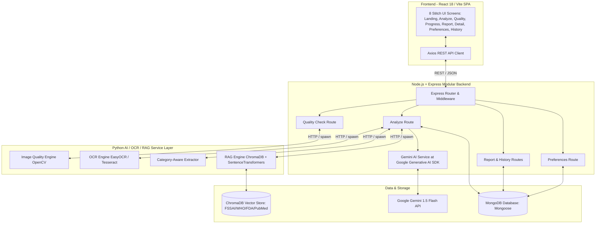
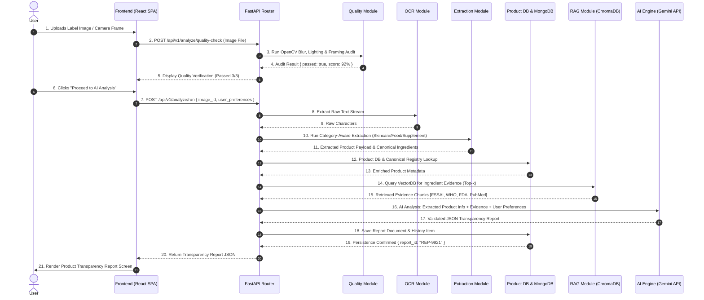
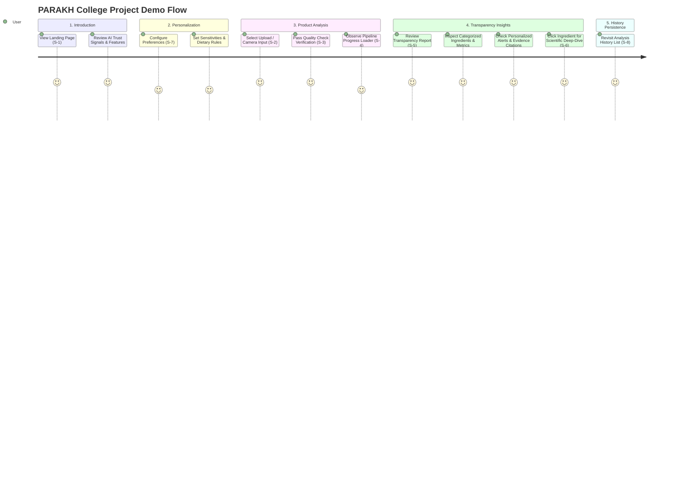

# PARAKH — Project Implementation Handbook

> **Single Source of Truth for Phase-by-Phase Development**  
> *AI-Powered Product Intelligence Platform using RAG*  
> **Backend Architecture:** FastAPI Modular Monolith (Python 3.11)  
> **Frontend Architecture:** React 18 + Vite + Tailwind CSS Single Page Application (SPA)

---

## 1. Project Overview

**PARAKH** (*Hindi for test, scrutinize, or verify*) is an AI-powered product intelligence platform designed to help everyday consumers understand product labels across **Skincare, Processed Foods, and Dietary Supplements**.

By combining Computer Vision (OCR), Category-Aware Product & Ingredient Extraction, a Curated Knowledge Base (FSSAI, WHO, FDA, PubMed), Retrieval-Augmented Generation (RAG), and Large Language Models (LLM), PARAKH translates dense chemical nomenclature (INCI), additive codes (E-numbers), and vague packaging claims into clear, evidence-backed, personalized transparency reports.

### Primary Principles & Boundaries
1. **Explainable & Evidence-Backed:** Every observation or alert is grounded in cited public health guidelines.
2. **Integrated Personalization:** Personal health goals, dietary preferences, and ingredient sensitivities are evaluated directly during AI analysis.
3. **Non-Medical Boundary:** PARAKH is an informational intelligence platform, **not** a medical diagnosis or prescription system. It communicates uncertainty explicitly whenever label image quality or regulatory evidence is incomplete.

---

## 2. Final Approved Scope

### Confirmed Core Scope (College MVP)
- **Multi-Input Ingestion:** Image file upload (drag-and-drop) and HTML5 webcam live video stream capture.
- **Automated Quality Verification:** OpenCV pre-check assessing sharpness (Laplacian variance), contrast histograms, and label framing bounding boxes before executing backend pipelines.
- **OCR Engine & Preprocessing:** OpenCV binarization/denoising + EasyOCR/Tesseract character extraction.
- **Category-Aware Extraction:** Multi-domain text parsing across Skincare (INCI), Processed Foods (FSSAI/INS additives), and Dietary Supplements.
- **Product DB & Knowledge Base:** MongoDB collections for verified product metadata and canonical ingredient dictionaries.
- **Local RAG Pipeline:** Local ChromaDB vector store with `all-MiniLM-L6-v2` embeddings, querying indexed chunks from FSSAI regulations, WHO standards, US FDA guides, and PubMed abstracts.
- **AI Analysis & Personalization Engine:** Single-stage Google Gemini API reasoning combining Extracted Product Info + RAG Evidence + User Preferences into structured JSON transparency reports.
- **Frontend Interface:** 8 visual reference screens implemented in React + Vite + Tailwind CSS, strictly matching Stitch design tokens.
- **Persistence & History:** MongoDB storage for user preference profiles, analysis reports, and search history index records.

### Optional Enhancements & Open Decisions
- **Barcode Search Fallback:** Optional / Future-Ready feature *(recorded under Open Decisions due to Project Report vs PPT scope difference)*.
- **PDF Report Exporter:** Optional Enhancement *(not required for core Phase 7 deliverables)*.

### Future Scope (Post-MVP)
- Real-time video scanning with instant bounding-box label overlay.
- E-commerce browser extension integration (Amazon, Nykaa, BigBasket).
- Multi-lingual OCR & report localization (Hindi, Tamil, Marathi, etc.).

---

## 3. Final Approved Tech Stack

| Component | Choice | Rationale | Scope Status |
| :--- | :--- | :--- | :--- |
| **Frontend SPA** | React 18 + Vite | Fast HMR, component modularity, clean state context management. | Confirmed Scope |
| **Styling & CSS** | Tailwind CSS v3 | Utility-first styling matching Stitch design tokens (`brand-900`, `hero-glow`). | Confirmed Scope |
| **Backend API** | Node.js + Express.js | **Primary MERN Backend** — team is experienced with this stack; JSON-native, rapid development cycle. | Confirmed Scope |
| **AI / OCR / RAG Service Layer** | Python Sidecar (invoked from Express) | Heavy ML operations (OpenCV, EasyOCR, ChromaDB, SentenceTransformers) run as a Python service, called by Express when needed. | Confirmed Scope |
| **Vision & Quality** | OpenCV (`cv2`) | Fast C++ backend wrappers for Laplacian blur variance and contrast calculations (< 50ms). | Confirmed Scope |
| **OCR Engine** | EasyOCR / Tesseract | Open-source, local execution with zero API cost per image scan. | Confirmed Scope |
| **Extraction Engine** | Python `re` + RapidFuzz | Multi-domain text parsing (Skincare, Food, Supplements) with fuzzy string dictionary matching. | Confirmed Scope |
| **Vector Store** | ChromaDB (Local Disk) | Local persistent vector DB (`./data/chroma_db`); zero cloud account friction. | Confirmed Scope |
| **Embedding Model** | `all-MiniLM-L6-v2` | Fast 384-dimensional local embeddings via SentenceTransformers; zero token cost. | Confirmed Scope |
| **Database** | MongoDB (Mongoose) | Document schema flexibility for nested ingredient lists, user preferences, and JSON reports. | Confirmed Scope |
| **LLM Engine** | Google Gemini 1.5 Flash | Fast execution (< 1.5s), free tier rate limits, native JSON mode via `@google/generative-ai` Node.js SDK. | Confirmed Scope |

---

## 4. Final System Architecture

PARAKH is organized as a **MERN Stack** application: a React SPA communicating with a Node.js + Express API. For AI-heavy operations (OCR, RAG, Embeddings), Express delegates to a Python AI Service layer.



---

## 5. End-to-End User Flow

$$\text{User Input} \rightarrow \text{Quality Check} \rightarrow \text{OCR / CV} \rightarrow \text{Product \& Ingredient Extraction} \rightarrow \text{Product DB / KB} \rightarrow \text{RAG Retrieval} \rightarrow \text{AI Analysis} \rightarrow \text{Transparency Report} \rightarrow \text{History}$$



---

## 6. Final Project Folder Structure

```
PARAKH/
├── docs/                        # Complete technical specifications & blueprints
│   ├── PROJECT_MASTER_PLAN.md
│   ├── PROJECT_OVERVIEW.md
│   ├── REQUIREMENTS.md
│   ├── SYSTEM_ARCHITECTURE.md
│   ├── FRONTEND_ARCHITECTURE.md
│   ├── BACKEND_ARCHITECTURE.md
│   ├── DATABASE_SCHEMA.md
│   ├── OCR_VISION_PIPELINE.md
│   ├── RAG_DESIGN.md
│   ├── AI_ANALYSIS_SPEC.md
│   ├── API_SPECIFICATION.md
│   ├── SECURITY_PRIVACY.md
│   ├── ERROR_HANDLING.md
│   ├── TEST_PLAN.md
│   ├── IMPLEMENTATION_PLAN.md
│   ├── TECH_STACK.md
│   ├── DECISIONS.md
│   └── PROJECT_IMPLEMENTATION_HANDBOOK.md
├── frontend/                    # React 18 + Vite SPA
│   ├── public/
│   │   └── favicon.svg
│   ├── src/
│   │   ├── assets/              # SVG icons, design tokens
│   │   ├── components/
│   │   │   ├── common/          # Navbar, Footer, ReticleOverlay, MetricCard, SourceBadge
│   │   │   ├── analyze/         # Dropzone, CameraScanner, SearchFallback (optional)
│   │   │   ├── quality/         # QualityAuditList, BoundingBoxView
│   │   │   ├── report/          # ReportHeader, MetricGrid, IngredientSection, EvidenceSection
│   │   │   └── history/         # HistoryToolbar, HistoryCard
│   │   ├── context/             # AnalysisContext, PreferenceContext
│   │   ├── hooks/               # useImageQuality, useCamera, useAnalysisApi
│   │   ├── pages/               # 8 Stitch Screen page components
│   │   │   ├── LandingPage.jsx
│   │   │   ├── AnalyzePage.jsx
│   │   │   ├── QualityCheckPage.jsx
│   │   │   ├── AnalyzingPage.jsx
│   │   │   ├── ReportPage.jsx
│   │   │   ├── IngredientDetailPage.jsx
│   │   │   ├── PersonalizationPage.jsx
│   │   │   └── HistoryPage.jsx
│   │   ├── services/            # Axios API client instance & endpoint methods
│   │   │   └── api.js
│   │   ├── styles/              # index.css (Tailwind directives & custom glows)
│   │   ├── App.jsx              # React Router configuration
│   │   └── main.jsx             # React DOM root entry
│   ├── index.html
│   ├── vite.config.js           # Vite config with /api proxy to Express
│   ├── tailwind.config.js       # Tailwind brand color tokens
│   └── package.json
├── server/                      # Node.js + Express Modular Backend (MERN)
│   ├── index.js                 # Express app entry point
│   ├── config/
│   │   └── db.js                # MongoDB connection setup (Mongoose)
│   ├── routes/
│   │   ├── analyze.js           # Quality check & full analysis routes
│   │   ├── report.js            # Report retrieval routes
│   │   ├── ingredient.js        # Ingredient detail routes
│   │   ├── preference.js        # User preference CRUD routes
│   │   └── history.js           # Analysis history routes
│   ├── controllers/             # Business logic handlers per route
│   ├── models/                  # Mongoose schema models
│   │   ├── Report.js
│   │   ├── Preference.js
│   │   ├── Product.js
│   │   └── AnalysisHistory.js
│   ├── middleware/              # Multer upload, error handler, logger
│   ├── services/                # Node.js service wrappers
│   │   ├── geminiService.js     # Google Generative AI SDK wrapper
│   │   └── aiSidecarClient.js   # HTTP client to call Python AI sidecar
│   ├── .env.example
│   └── package.json
├── ai_service/                  # Python AI / OCR / RAG Sidecar (Phase 3 onwards)
│   ├── main.py                  # FastAPI or Flask HTTP service entry
│   ├── services/
│   │   ├── quality_service.py
│   │   ├── ocr_service.py
│   │   ├── extraction_service.py
│   │   └── rag_service.py
│   ├── db/
│   │   └── vector_store.py
│   ├── data/
│   │   ├── kb_documents/
│   │   ├── chroma_db/
│   │   └── dictionaries/
│   ├── scripts/
│   │   └── ingest_knowledge_docs.py
│   ├── requirements.txt
│   └── .env.example
└── README.md
```

---

## 7. Development Rules & Coding Standards

1. **Strict Separations of Concerns:** Keep React component logic separate from API calls. All network requests must flow through `src/services/api.js`.
2. **Express Middleware Validation:** All Express endpoint inputs must be validated (using `express-validator` or equivalent) before passing data to controllers.
3. **Zero Secrets in Code:** Backend API keys (`GEMINI_API_KEY`, `MONGO_URI`) must strictly reside in `server/.env` and `ai_service/.env` files and must never be committed to version control.
4. **Non-Medical Disclaimer Boundary:** Ensure that every report and ingredient UI view displays the standard non-medical disclaimer banner.
5. **No Invented Dependencies:** Use only verified dependencies. Node.js side: `express`, `mongoose`, `multer`, `cors`, `dotenv`, `axios`, `@google/generative-ai`. Python AI sidecar: `fastapi` (or `flask`), `uvicorn`, `opencv-python`, `easyocr`, `chromadb`, `sentence-transformers`, `rapidfuzz`.
6. **MERN is Primary:** All user-facing REST routes, authentication scaffolding, and data persistence are handled exclusively by the Node.js + Express server. The Python AI sidecar is an internal tool invoked by Express, not exposed to the client.

---

## 8. 10-Phase Implementation Roadmap (Phase 0 to Phase 10)

---

### Phase 0 — Project Foundation
- **Phase Objective:** Establish the MERN project scaffold — React + Vite frontend, Node.js + Express backend, MongoDB configuration structure, and verified bidirectional communication.
- **Prerequisites / Dependencies:** Installed Node.js 18+, MongoDB (local or Atlas), npm.
- **Exact Development Tasks:**
  1. Create root directory structure (`frontend/`, `server/`, `ai_service/` placeholder).
  2. Initialize React Vite SPA inside `frontend/` (`npm create vite@latest frontend -- --template react`).
  3. Install Tailwind CSS v3; configure `tailwind.config.js` with brand color tokens (`brand-900` `#064e3b`, hero radial glow utility).
  4. Initialize Node.js Express backend inside `server/` (`npm init -y`); install `express`, `cors`, `dotenv`, `mongoose`, `multer`.
  5. Create `server/index.js` with Express app, CORS middleware, body-parser, and a single `GET /api/health` endpoint.
  6. Configure `server/config/db.js` as the MongoDB Mongoose connection module (no collections implemented yet).
  7. Create `server/.env` and `server/.env.example` with `PORT`, `MONGO_URI`, and `GEMINI_API_KEY` keys.
  8. Configure Vite `server.proxy` in `frontend/vite.config.js` to proxy `/api/*` requests to `http://localhost:5001`.
  9. Create `frontend/src/services/api.js` as the Axios base client pointing to `/api`.
- **Relevant Files to Create/Modify:**
  - `frontend/package.json`, `frontend/vite.config.js`, `frontend/tailwind.config.js`, `frontend/src/styles/index.css`, `frontend/src/services/api.js`
  - `server/index.js`, `server/package.json`, `server/config/db.js`, `server/.env`, `server/.env.example`
- **APIs / Data Flow Involved:** `GET /api/health` → Express → `{ status: 'ok', service: 'PARAKH API', version: '1.0.0' }`.
- **Testing Checklist:**
  - [ ] React Vite dev server launches on port 5173 (`npm run dev`).
  - [ ] Express server launches on port 5001 (`node index.js` or `nodemon`).
  - [ ] `GET http://localhost:5001/api/health` returns `200 OK` with correct JSON.
  - [ ] Vite proxy correctly forwards `GET /api/health` from port 5173 to Express port 5001.
  - [ ] Brand Tailwind tokens render correctly in browser (spot check a background color).
  - [ ] `MONGO_URI` is loaded from `.env` and Mongoose connect is called (log confirms connection).
- **Definition of Done:** Frontend and backend run concurrently; Vite proxies `/api/*` to Express; health endpoint responds; brand Tailwind theme loads; MongoDB connection is established and confirmed in terminal logs.
- **Dependency on Next Phase:** Provides runnable MERN foundation for Phase 1 to mount React Router and build 8 Stitch screens.

---

### Phase 1 — Frontend UI + Navigation (The 8 Stitch Screens)
- **Phase Objective:** Build all 8 visual reference screens as React component routes matching Stitch code specifications.
- **Prerequisites / Dependencies:** Phase 0.
- **Exact Development Tasks:**
  1. Configure `react-router-dom` in `src/App.jsx`.
  2. Build `Navbar.jsx` and `Footer.jsx` with brand logo and non-medical disclaimer footer.
  3. Create 8 page views (`LandingPage`, `AnalyzePage`, `QualityCheckPage`, `AnalyzingPage`, `ReportPage`, `IngredientDetailPage`, `PersonalizationPage`, `HistoryPage`).
  4. Implement visual design elements: reticle scanner overlays, pill badges, ambient radial background glows, metric card grids.
- **Relevant Files to Create/Modify:**
  - `frontend/src/App.jsx`
  - `frontend/src/components/common/` (`Navbar.jsx`, `Footer.jsx`, `ReticleOverlay.jsx`)
  - `frontend/src/pages/` (8 Page components)
- **APIs / Data Flow Involved:** Client-side React Router navigation (`useNavigate`, `Link`).
- **Testing Checklist:**
  - [ ] Navigating between all 8 routes functions cleanly without page reload.
  - [ ] Visual layout matches Stitch code (emerald palette, Jakarta Sans font, rounded card containers).
  - [ ] Responsive layout verified across mobile, tablet, and desktop viewports.
- **Definition of Done:** All 8 screens rendered and navigable using static mock demonstration payloads.
- **Dependency on Next Phase:** Establishes screen S-2 (`/analyze`) for wiring product upload controls in Phase 2.

---

### Phase 2 — Product Input System
- **Phase Objective:** Implement file drag-and-drop upload, HTML5 webcam stream capture, and optional barcode search tab.
- **Prerequisites / Dependencies:** Phase 1.
- **Exact Development Tasks:**
  1. Build `Dropzone.jsx` using `react-dropzone` for handling `.jpg`, `.png`, and `.webp` file selection.
  2. Build `CameraScanner.jsx` using HTML5 `navigator.mediaDevices.getUserMedia` for webcam frame capture.
  3. Build `SearchFallback.jsx` for optional barcode/text search *(optional future-ready feature)*.
  4. Store captured image file in `AnalysisContext`.
- **Relevant Files to Create/Modify:**
  - `frontend/src/components/analyze/Dropzone.jsx`
  - `frontend/src/components/analyze/CameraScanner.jsx`
  - `frontend/src/components/analyze/SearchFallback.jsx`
  - `frontend/src/context/AnalysisContext.jsx`
- **APIs / Data Flow Involved:** Client-side image File to DataURL / Blob conversion.
- **Testing Checklist:**
  - [ ] Drag-and-drop file selection captures file object and navigates to `/quality-check`.
  - [ ] Webcam scanner displays live camera feed and takes snapshot frame cleanly.
- **Definition of Done:** User can upload or capture a label photo and navigate into the quality check view.
- **Dependency on Next Phase:** Provides raw image data for backend OpenCV quality verification in Phase 3.

---

### Phase 3 — OCR + Computer Vision
- **Phase Objective:** Implement OpenCV quality verification endpoint and EasyOCR text extraction service.
- **Prerequisites / Dependencies:** Phase 2.
- **Exact Development Tasks:**
  1. Build `QualityService` (`quality_service.py`): OpenCV Laplacian blur variance calculation, brightness histogram evaluation, and Canny contour bounding box check.
  2. Build `OCRService` (`ocr_service.py`): Image binarization, adaptive thresholding, and EasyOCR character extraction.
  3. Create `POST /api/v1/analyze/quality-check` endpoint in `endpoints/analyze.py`.
- **Relevant Files to Create/Modify:**
  - `backend/app/services/quality_service.py`
  - `backend/app/services/ocr_service.py`
  - `backend/app/api/v1/endpoints/analyze.py`
  - `backend/app/schemas/quality.py`
- **APIs / Data Flow Involved:** `POST /api/v1/analyze/quality-check` (`multipart/form-data` -> `QualityAuditResponse` JSON).
- **Testing Checklist:**
  - [ ] OpenCV flags blurry test photo (`Laplacian variance < 100.0`).
  - [ ] EasyOCR extracts raw text stream from valid label photos.
- **Definition of Done:** Quality check endpoint returns validation metrics; OCR extracts raw label character stream.
- **Dependency on Next Phase:** Provides raw text stream for category-aware parsing in Phase 4.

---

### Phase 4 — Category-Aware Product & Ingredient Extraction
- **Phase Objective:** Build multi-domain extraction engine parsing ingredients across Skincare (INCI), Food (FSSAI/INS additives), and Supplements.
- **Prerequisites / Dependencies:** Phase 3.
- **Exact Development Tasks:**
  1. Create canonical multi-domain ingredient dictionaries (`backend/data/dictionaries/`).
  2. Build `ExtractionService` (`extraction_service.py`): Domain detector, header/delimiter isolator, RapidFuzz fuzzy string matching ($\ge 80\%$ similarity).
  3. Output structured `ExtractedProductPayload` (Category, Product Name, Canonical Ingredient List).
- **Relevant Files to Create/Modify:**
  - `backend/app/services/extraction_service.py`
  - `backend/data/dictionaries/` (`skincare_inci.json`, `food_additives.json`, `supplements.json`)
  - `backend/app/schemas/ingredient.py`
- **APIs / Data Flow Involved:** Internal Python data flow (Raw OCR Text -> `ExtractedProductPayload`).
- **Testing Checklist:**
  - [ ] Parses cosmetic label into INCI ingredient array.
  - [ ] Parses food label into FSSAI ingredient & additive array.
  - [ ] Fuzzy matching maps raw strings to canonical dictionary entries with score $\ge 80\%$.
- **Definition of Done:** Extraction service turns raw OCR text into normalized product and ingredient payloads.
- **Dependency on Next Phase:** Provides canonical ingredient payload for database lookups in Phase 5.

---

### Phase 5 — Product Database + Knowledge Base Ingestion
- **Phase Objective:** Setup MongoDB collections and ingest regulatory documents (FSSAI, WHO, FDA, PubMed).
- **Prerequisites / Dependencies:** Phase 4.
- **Exact Development Tasks:**
  1. Build MongoDB connection pool (`db/mongo.py`) using Motor async driver.
  2. Build `ProductDBService` (`product_db_service.py`) for matching product records and canonical ingredient definitions.
  3. Create ingestion script `scripts/ingest_knowledge_docs.py` to clean and chunk regulatory PDFs/JSONs.
- **Relevant Files to Create/Modify:**
  - `backend/app/db/mongo.py`, `backend/app/db/models.py`
  - `backend/app/services/product_db_service.py`
  - `backend/scripts/ingest_knowledge_docs.py`
- **APIs / Data Flow Involved:** Motor async MongoDB read/write queries.
- **Testing Checklist:**
  - [ ] MongoDB connects successfully and initializes `products`, `ingredients`, and `reports` collections.
  - [ ] Ingestion script cleans and chunks regulatory PDFs/JSONs.
- **Definition of Done:** Product DB lookup operational; regulatory text prepared for vector indexing.
- **Dependency on Next Phase:** Provides chunked regulatory text for vector embedding in Phase 6.

---

### Phase 6 — RAG Pipeline
- **Phase Objective:** Setup local ChromaDB vector store, generate embeddings, and build semantic evidence retrieval.
- **Prerequisites / Dependencies:** Phase 5.
- **Exact Development Tasks:**
  1. Initialize ChromaDB client (`db/vector_store.py`) pointing to local path `./data/chroma_db`.
  2. Index chunked documents using `sentence-transformers/all-MiniLM-L6-v2`.
  3. Build `RAGService` (`rag_service.py`): Vector similarity search with similarity threshold $\ge 0.65$ and metadata filtering.
- **Relevant Files to Create/Modify:**
  - `backend/app/db/vector_store.py`
  - `backend/app/services/rag_service.py`
  - `backend/tests/test_rag.py`
- **APIs / Data Flow Involved:** ChromaDB vector query -> `EvidenceContext` object with source citations.
- **Testing Checklist:**
  - [ ] ChromaDB stores indexed chunks with metadata tags (`authority`, `source`).
  - [ ] Querying "Niacinamide" returns top-3 relevant regulatory passages with similarity $\ge 0.65$.
- **Definition of Done:** RAG service retrieves evidence chunks with source citations in `< 200ms`.
- **Dependency on Next Phase:** Provides evidence context for AI Analysis in Phase 7.

---

### Phase 7 — AI Analysis + Personalization
- **Phase Objective:** Integrate Google Gemini API, build prompt template, and execute integrated personalization analysis.
- **Prerequisites / Dependencies:** Phase 4, Phase 6.
- **Exact Development Tasks:**
  1. Build `AIAnalysisService` (`ai_analysis_service.py`) using `google-genai` client.
  2. Construct single-stage LLM prompt template accepting Extracted Product Info + RAG Evidence + User Preferences.
  3. Enforce strict JSON output mode (`response_mime_type="application/json"`) validated against `AI_ANALYSIS_SPEC.md` Pydantic schema.
  4. Create `POST /api/v1/analyze/run` endpoint in `endpoints/analyze.py`.
- **Relevant Files to Create/Modify:**
  - `backend/app/services/ai_analysis_service.py`
  - `backend/app/schemas/report.py`
  - `backend/app/api/v1/endpoints/analyze.py`
- **APIs / Data Flow Involved:** `POST /api/v1/analyze/run` -> Structured `TransparencyReport` JSON payload.
- **Testing Checklist:**
  - [ ] Gemini API returns valid JSON matching `AI_ANALYSIS_SPEC.md` schema.
  - [ ] User sensitivity preference (e.g., "fragrance") triggers highlighted warning in `personalized_insights`.
  - [ ] Mathematical confidence score calculated correctly.
- **Definition of Done:** AI analysis pipeline generates validated JSON transparency reports incorporating personalized insights.
- **Dependency on Next Phase:** Provides report JSON payload for rendering and history persistence in Phase 8.

---

### Phase 8 — Transparency Report UI + History Persistence
- **Phase Objective:** Render complete transparency report UI (S-5), store report records in MongoDB, and render history list (S-8).
- **Prerequisites / Dependencies:** Phase 7.
- **Exact Development Tasks:**
  1. Connect `ReportPage.jsx` (S-5) to render live report JSON from backend.
  2. Implement `MetricGrid.jsx`, `IngredientSection.jsx`, and `EvidenceSection.jsx` components.
  3. Save generated reports and history summary items to MongoDB (`reports` and `analysis_history` collections).
  4. Build `HistoryPage.jsx` (S-8) with category filter pills, search bar, and date sorting.
  5. Build optional `pdf_service.py` *(Optional Enhancement)*.
- **Relevant Files to Create/Modify:**
  - `frontend/src/pages/ReportPage.jsx`, `HistoryPage.jsx`
  - `frontend/src/components/report/` (`MetricGrid.jsx`, `IngredientSection.jsx`, `EvidenceSection.jsx`)
  - `backend/app/api/v1/endpoints/history.py`
  - `backend/app/services/pdf_service.py` *(Optional)*
- **APIs / Data Flow Involved:** `GET /api/v1/reports/{report_id}`, `GET /api/v1/history`.
- **Testing Checklist:**
  - [ ] Report screen renders live analysis JSON with metric badges and evidence callouts.
  - [ ] Analyzed products auto-save to MongoDB and appear in user history list.
  - [ ] History list filters items by category and search text.
- **Definition of Done:** Report view displays full intelligence metrics and persists records to history.
- **Dependency on Next Phase:** Provides end-to-end functionality for error handling verification in Phase 9.

---

### Phase 9 — Error Handling + Edge Cases
- **Phase Objective:** Implement client error boundaries, quality check failure screens, and sparse evidence fallbacks.
- **Prerequisites / Dependencies:** Phase 8.
- **Exact Development Tasks:**
  1. Implement FastAPI global exception handler middleware in `core/exceptions.py`.
  2. Implement React `ErrorBoundary.jsx` component.
  3. Wire quality check failure screen (S-3) with actionable feedback (blur, lighting alerts) and Retake CTA.
  4. Implement manual ingredient text editor modal for low-confidence OCR states.
  5. Add sparse evidence badge rendering when RAG similarity is below threshold.
- **Relevant Files to Create/Modify:**
  - `backend/app/core/exceptions.py`
  - `frontend/src/components/common/ErrorBoundary.jsx`
  - `frontend/src/pages/QualityCheckPage.jsx`
- **APIs / Data Flow Involved:** Standardized JSON error response handling (`ERR_IMAGE_BLURRY`, `ERR_OCR_ZERO_TEXT`).
- **Testing Checklist:**
  - [ ] Uploading blurry photo triggers Screen S-3 quality check failure with retake CTA.
  - [ ] LLM timeout triggers rule-based report fallback without breaking UI layout.
  - [ ] Sparse RAG evidence displays explicit uncertainty notice.
- **Definition of Done:** Application handles all failure states cleanly with user recovery options.
- **Dependency on Next Phase:** Ensures robust error handling before final integration testing in Phase 10.

---

### Phase 10 — Full Integration + Testing + Demo Polish
- **Phase Objective:** Execute end-to-end integration tests, optimize responsive layouts, polish animations, and prepare demo assets.
- **Prerequisites / Dependencies:** Phase 9.
- **Exact Development Tasks:**
  1. Write and run automated integration test `tests/integration/test_full_flow.py`.
  2. Polish Tailwind micro-animations (scanning reticle, loading shimmer, hover transitions).
  3. Verify non-medical disclaimers are visible across all report views.
  4. Prepare demo dataset (sample sharp skincare, food, and supplement label photos).
- **Relevant Files to Create/Modify:**
  - `backend/tests/integration/test_full_flow.py`
  - `frontend/src/assets/demo/`
- **APIs / Data Flow Involved:** Complete End-to-End system pipeline execution.
- **Testing Checklist:**
  - [ ] End-to-end flow executes from Landing Page to Report in `< 5.0 seconds`.
  - [ ] Zero unhandled errors in browser devtools console.
  - [ ] Non-medical disclaimer clearly visible on all report views.
- **Definition of Done:** Project is feature-complete, fully tested, and presentation-ready.
- **Dependency on Next Phase:** Project ready for college submission and final demo.

---

## 9. Testing Strategy

1. **Unit Testing (Pytest):** Test OpenCV image quality calculations, EasyOCR extraction, category-aware extraction logic, and Pydantic schema parsing.
2. **RAG Recall Evaluation:** Verify vector similarity retrieval metrics (Recall@3 $\ge 0.85$) for canonical ingredients.
3. **Medical Safety Compliance Audit:** Automated string assertions guaranteeing no prohibited medical claims (`cure`, `diagnose`, `prescribe`, `100% safe`) appear in AI output.
4. **Frontend Component Testing:** React component rendering tests ensuring all 8 Stitch routes render without errors.
5. **End-to-End Flow Verification:** Automated integration script validating the 9-step pipeline execution.

---

## 10. Final Demo Flow



---

## 11. Open Decisions & Future Scope Summary

| Item | Category | Resolution / Current Status |
| :--- | :--- | :--- |
| **Primary Backend Stack** | Validated | **MERN Stack** — Node.js + Express as primary API backend. Python AI sidecar for OCR/RAG operations. |
| **Pipeline Workflow** | Validated | Corrected 9-step pipeline (Input -> Quality Check -> OCR -> Extraction -> Product DB -> RAG -> AI Analysis -> Report -> History). |
| **Category-Aware Extraction** | Validated | Multi-domain extraction handling Skincare (INCI), Processed Foods (FSSAI/INS additives), and Supplements (Python AI sidecar). |
| **Integrated Personalization** | Validated | Personalization evaluated directly in AI Analysis prompt step via Gemini Node.js SDK. |
| **Barcode Search Tab** | Open Decision | Optional / Future-Ready feature (recorded due to Report vs PPT scope difference). |
| **PDF Report Exporter** | Open Decision | Optional Enhancement (not required for core Phase 7 deliverables). |
| **Non-Medical Boundary** | Validated | Enforced programmatically in LLM prompts and UI disclaimers. |
