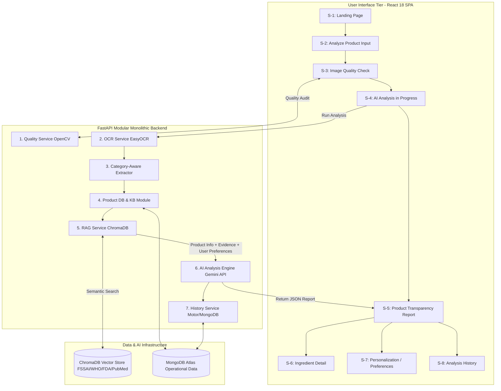

# PARAKH — Project Master Plan & Blueprint Index

## Executive Overview
This **Project Master Plan** serves as the single source of truth for **PARAKH — AI-Powered Product Intelligence Platform using RAG**. It integrates all system blueprints, database schemas, pipeline specifications, and implementation phases into a cohesive technical strategy for a **FastAPI Modular Monolithic Backend** and React SPA.

---

## 1. Documentation Map & Blueprint Index

All technical documentation resides in the `/docs` directory:

| Blueprint File | Document Title & Purpose | Key Contents | Scope Status |
| :--- | :--- | :--- | :--- |
| [`PROJECT_OVERVIEW.md`](file:///c:/Users/HP/Desktop/PARAKH/docs/PROJECT_OVERVIEW.md) | Executive Summary & Core Concept | Problem statement, target personas, corrected 9-step workflow, scope boundaries. | Confirmed Scope |
| [`REQUIREMENTS.md`](file:///c:/Users/HP/Desktop/PARAKH/docs/REQUIREMENTS.md) | Functional & Non-Functional Requirements | FR-1 to FR-10 functional specs, category-aware extraction, integrated personalization. | Confirmed Scope |
| [`SYSTEM_ARCHITECTURE.md`](file:///c:/Users/HP/Desktop/PARAKH/docs/SYSTEM_ARCHITECTURE.md) | High-Level System Architecture | FastAPI Modular Monolith tier diagrams, sequence flows, component matrix. | Confirmed Scope |
| [`FRONTEND_ARCHITECTURE.md`](file:///c:/Users/HP/Desktop/PARAKH/docs/FRONTEND_ARCHITECTURE.md) | Frontend & 8 Stitch Screen Specification | React component tree, Stitch design system tokens, client state architecture. | Confirmed Scope |
| [`BACKEND_ARCHITECTURE.md`](file:///c:/Users/HP/Desktop/PARAKH/docs/BACKEND_ARCHITECTURE.md) | Backend FastAPI Modular Monolith | Directory structure, corrected execution pipeline, service module contracts. | Confirmed Scope |
| [`DATABASE_SCHEMA.md`](file:///c:/Users/HP/Desktop/PARAKH/docs/DATABASE_SCHEMA.md) | MongoDB Database Schemas | Collections: `users`, `preferences`, `products`, `ingredients`, `reports`, `history`. | Confirmed Scope |
| [`OCR_VISION_PIPELINE.md`](file:///c:/Users/HP/Desktop/PARAKH/docs/OCR_VISION_PIPELINE.md) | Computer Vision & Extraction Pipeline | Laplacian blur test math, OpenCV preprocessing, Category-Aware Extraction. | Confirmed Scope |
| [`RAG_DESIGN.md`](file:///c:/Users/HP/Desktop/PARAKH/docs/RAG_DESIGN.md) | Retrieval-Augmented Generation | Document sources (FSSAI/WHO/FDA/PubMed), ChromaDB schema, semantic search. | Confirmed Scope |
| [`AI_ANALYSIS_SPEC.md`](file:///c:/Users/HP/Desktop/PARAKH/docs/AI_ANALYSIS_SPEC.md) | AI Contract & JSON Schema | Integrated prompt contract (Product Info + Evidence + Preferences -> Report). | Confirmed Scope |
| [`API_SPECIFICATION.md`](file:///c:/Users/HP/Desktop/PARAKH/docs/API_SPECIFICATION.md) | REST API Endpoint Specification | Endpoint definitions, request/response models, OpenAPI error handling. | Confirmed Scope |
| [`SECURITY_PRIVACY.md`](file:///c:/Users/HP/Desktop/PARAKH/docs/SECURITY_PRIVACY.md) | Security, Privacy & Non-Medical Guardrails | API key isolation (`.env`), transient image cleanup, non-medical legal boundary. | Confirmed Scope |
| [`ERROR_HANDLING.md`](file:///c:/Users/HP/Desktop/PARAKH/docs/ERROR_HANDLING.md) | Error Handling & Edge Case Matrix | Master error code table, fallback workflows for blurry/sparse/failed states. | Confirmed Scope |
| [`TEST_PLAN.md`](file:///c:/Users/HP/Desktop/PARAKH/docs/TEST_PLAN.md) | Testing Strategy & QA Plan | Unit testing, category-aware extraction tests, medical safety audits, E2E flow. | Confirmed Scope |
| [`IMPLEMENTATION_PLAN.md`](file:///c:/Users/HP/Desktop/PARAKH/docs/IMPLEMENTATION_PLAN.md) | 11-Phase Implementation Roadmap | Phase 0 to Phase 10 execution plan, dependencies, completion criteria. | Confirmed Scope |
| [`TECH_STACK.md`](file:///c:/Users/HP/Desktop/PARAKH/docs/TECH_STACK.md) | Technology Choices & Rationale | Evaluation of React, FastAPI Modular Monolith, OpenCV, ChromaDB, MongoDB, Gemini API. | Confirmed Scope |
| [`DECISIONS.md`](file:///c:/Users/HP/Desktop/PARAKH/docs/DECISIONS.md) | Architectural Decision Records | ADR-001 to ADR-009 key engineering decisions and trade-offs. | Confirmed Scope |

---

## 2. Integrated System Workflow

---

## 3. Scope Classification Summary

| Feature / Capability | Category | Description |
| :--- | :--- | :--- |
| **Image Upload & Webcam Scan** | Confirmed Scope | Core label photo ingestion methods. |
| **OpenCV Image Quality Check** | Confirmed Scope | Pre-analysis blur, lighting, and framing audit. |
| **EasyOCR / Tesseract Text Extraction** | Confirmed Scope | Raw label character extraction. |
| **Category-Aware Extraction Layer** | Confirmed Scope | Multi-domain parsing across Skincare (INCI), Food (FSSAI/INS additives), and Dietary Supplements. |
| **Product DB & Canonical Registries** | Confirmed Scope | MongoDB product lookup and ingredient dictionary mapping. |
| **ChromaDB Local RAG Pipeline** | Confirmed Scope | Semantic retrieval over FSSAI, WHO, FDA, and PubMed knowledge chunks. |
| **Single-Stage AI Analysis & Personalization** | Confirmed Scope | Gemini API synthesis combining Product Info + Evidence + User Preferences into JSON transparency reports. |
| **React SPA (8 Stitch Screens)** | Confirmed Scope | Client UI implementing all 8 visual reference designs. |
| **MongoDB History Persistence** | Confirmed Scope | Storing user preference profiles, reports, and search history index. |
| **Barcode Search Tab** | Optional / Future-Ready | Optional search feature (recorded under Open Decisions due to Report vs PPT discrepancy). |
| **PDF Export Generator** | Optional Enhancement | Optional report export feature. |

---

## 4. Final Blueprint Verification Checklist

- [x] All 17 documentation files updated in `/docs`.
- [x] Architecture explicitly specified as **FastAPI Modular Backend** (not microservices).
- [x] Core 9-step pipeline corrected: User Input -> Quality Check -> OCR/CV -> Category-Aware Extraction -> Product DB/KB -> RAG -> AI Analysis (with User Preferences) -> Transparency Report -> History.
- [x] Universal INCI parsing replaced with Category-Aware Multi-Domain Extraction (skincare, food, supplements).
- [x] Barcode search recorded under Open Decisions / Ambiguities as optional/future-ready.
- [x] PDF export classified as an Optional Enhancement.
- [x] Personalization integrated directly into AI Analysis prompt pipeline.
- [x] Phase 0 to Phase 10 roadmap dependencies updated to reflect corrected pipeline.
- [x] Zero application code written prior to user approval.
