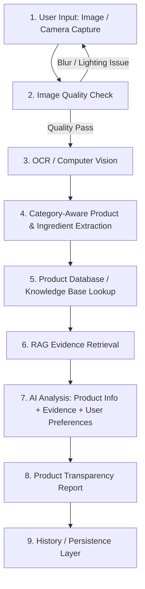

# PARAKH — AI-Powered Product Intelligence Platform using RAG

## Executive Summary
**PARAKH** (Hindi for *test*, *scrutinize*, or *verify*) is an AI-powered product intelligence platform designed to help consumers understand product labels across multiple categories—including skincare, processed foods, and dietary supplements. By combining Computer Vision (OCR), Category-Aware Product & Ingredient Extraction, a Curated Knowledge Base (FSSAI, WHO, FDA, PubMed), Retrieval-Augmented Generation (RAG), and Large Language Models (LLM), PARAKH translates complex ingredient lists and regulatory jargon into clear, evidence-backed transparency reports personalized to user preferences.

---

## 1. Problem Statement
Modern consumer products across food, skincare, and supplement domains use dense ingredient nomenclature, additive codes (E-numbers), vague marketing claims, and compact typography. 

### Key Consumer Challenges:
1. **Opacities & Misleading Marketing:** Labels mask questionable additives, preservatives, and allergens behind technical names.
2. **Health Sensitivities & Dietary Restrictions:** Consumers with allergies (e.g., nuts, gluten, lactose) or specific sensitivities (e.g., fragrance, parabens, sulfates) struggle to spot problematic ingredients quickly.
3. **Information Overload & Lack of Evidence:** Existing scanning apps rely on static, opaque scoring algorithms without providing verifiable sources or context from trusted health agencies.
4. **Lack of Personalization:** A product safe for one individual may trigger adverse reactions in another based on personal health goals or skin types.

---

## 2. Platform Mission & Non-Goals

### Mission
To bridge the gap between complex product packaging and consumer safety by providing transparent, verifiable, evidence-supported product intelligence tailored to individual user preferences.

### Explicit Non-Goals (Boundary Conditions)
> [!IMPORTANT]
> **PARAKH is NOT a medical diagnosis, treatment, or prescription tool.**
> - It does **not** evaluate individual medical conditions or replace certified medical/dermatological/dietary advice.
> - It does **not** make absolute safety guarantees ("100% safe for all humans").
> - It communicates uncertainty explicitly whenever label image clarity is degraded or regulatory evidence is incomplete.

---

## 3. Corrected End-to-End Core Workflow

The documented and corrected PARAKH system executes a strict 9-step intelligence pipeline:

---

## 4. Scope Classification

### Confirmed Current Scope (Core College MVP)
- **Multi-Input Ingestion:** Image upload (drag-and-drop) and Live camera stream capture.
- **Automated Quality Verification:** Image sharpness, contrast, and label framing pre-check before hitting backend processing APIs.
- **OCR Engine & Preprocessing:** OpenCV image binarization/noise reduction + EasyOCR/Tesseract text extraction.
- **Category-Aware Extraction:** Multi-domain ingredient extraction handling Skincare (INCI), Food (FSSAI/Additives), and Dietary Supplements.
- **Product DB & Knowledge Base:** MongoDB storage for verified product metadata and canonical ingredient registries.
- **Local RAG Pipeline:** Vector embeddings stored in ChromaDB/FAISS referencing official regulatory documents (FSSAI regulations, WHO standards, FDA guides, PubMed abstracts).
- **AI Analysis & Personalization Engine:** Single-stage LLM reasoning taking Extracted Product Info + RAG Evidence + User Preferences to generate structured JSON transparency reports.
- **Persistence & History:** MongoDB storage for user preference profiles, analysis reports, and search history.

### Optional Enhancements (Proposed / Conditional)
- **Barcode Search Fallback:** Optional/future-ready feature (noted as an open ambiguity between Project Report and PPT).
- **PDF Export:** Optional enhancement (not required for core Phase 7 deliverables).

### Future Scope (Post-MVP)
- Real-time video scanning with instant bounding-box label overlay.
- E-commerce browser extension integration (Amazon, Nykaa, BigBasket).
- Multi-lingual OCR & report localization (Hindi, Tamil, Marathi, etc.).
- Collaborative user reviews & community product flagging.

---

## 5. Traceability Matrix

This blueprint synthesizes four authoritative project artifacts:
1. **Official PARAKH Project Report:** Primary source of truth for workflow, RAG architecture, and trusted source hierarchy.
2. **Official PARAKH Presentation (PPT):** Technology stack guidelines and phase delivery model.
3. **Stitch UI Reference Screenshots:** Visual layout specifications and design tokens.
4. **Stitch Exported Code Reference:** Component hierarchy, screen routes, and visual micro-interactions.
