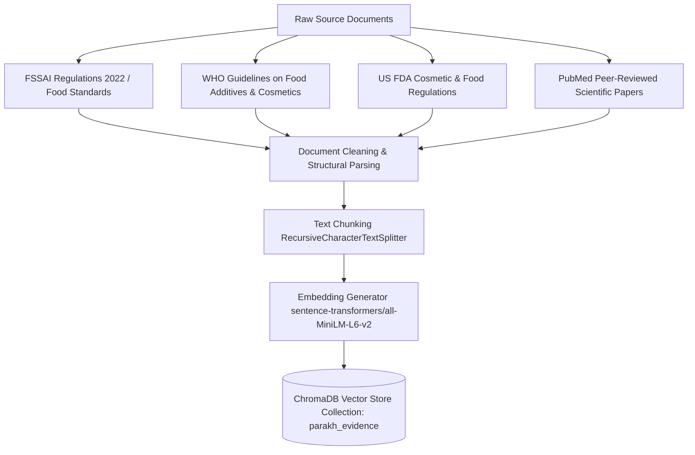

# PARAKH — Retrieval-Augmented Generation (RAG) Architecture

## Executive Overview
The RAG pipeline is the evidence retrieval engine for PARAKH. It receives normalized product and ingredient payloads from the **Product & Ingredient Extraction and Database Layer**, then queries indexed regulatory and scientific documents (FSSAI, WHO, FDA, PubMed) to return cited evidence chunks.

---

## 1. Document Knowledge Hierarchy



### Trusted Source Hierarchy & Weights

| Authority Tag | Document Source | Domain Coverage | Authority Weight |
| :--- | :--- | :--- | :--- |
| `FSSAI` | Food Safety and Standards Authority of India (Regulations 2022) | Primary Indian Regulatory Benchmark | **1.00 (Highest Priority)** |
| `WHO` | World Health Organization Technical Reports & Codex Alimentarius | International Global Health Standard | **0.95** |
| `FDA` | US Food & Drug Administration (Cosmetic & Food Additive Guidelines) | International Regulatory Benchmark | **0.90** |
| `PubMed` | NCBI PubMed Peer-Reviewed Clinical & Toxicological Literature | Peer-Reviewed Scientific Research | **0.85** |

---

## 2. Ingestion & Embedding Parameters

- **Text Splitter:** `RecursiveCharacterTextSplitter` (Chunk Size: `512 characters`, Overlap: `64 characters`).
- **Embedding Model:** `sentence-transformers/all-MiniLM-L6-v2` (384 dimensions, running locally).

---

## 3. Vector Database Schema (ChromaDB)

### Collection Name: `parakh_evidence`

```json
{
  "id": "chunk_fssai_2022_sec4_012",
  "document": "According to FSSAI Food Safety Regulations 2022, preservatives such as Phenoxyethanol must not exceed a maximum concentration of 1.0% in consumer formulations.",
  "metadata": {
    "source_id": "KS-FSSAI-2022-SEC4",
    "authority": "FSSAI",
    "title": "FSSAI Food Safety and Standards Regulations 2022",
    "section": "Section 4.1: Preservatives & Additives",
    "year": 2022,
    "ingredient_keyword": "phenoxyethanol",
    "domain": "General / Preservatives"
  }
}
```

---

## 4. Semantic Retrieval Algorithm

The RAG service receives the extracted ingredient payload from the Product & Ingredient Extraction Layer:

```python
class PARAKHRagEngine:
    def __init__(self, chroma_path: str = "./data/chroma_db"):
        self.client = PersistentClient(path=chroma_path)
        self.collection = self.client.get_or_create_collection(name="parakh_evidence")
        self.model = SentenceTransformer('sentence-transformers/all-MiniLM-L6-v2')

    def retrieve_ingredient_evidence(self, ingredient_name: str, top_k: int = 3) -> list:
        query_vector = self.model.encode(ingredient_name).tolist()

        results = self.collection.query(
            query_embeddings=[query_vector],
            n_results=top_k
        )

        evidence_chunks = []
        if results and results['documents']:
            for doc, meta, dist in zip(results['documents'][0], results['metadatas'][0], results['distances'][0]):
                similarity = 1.0 - (dist / 2.0)
                if similarity >= 0.65:
                    evidence_chunks.append({
                        "quote": doc,
                        "authority": meta.get("authority"),
                        "source": meta.get("title"),
                        "section": meta.get("section"),
                        "similarity": round(similarity, 4)
                    })

        return evidence_chunks
```

---

## 5. Context Assembly & Sparse Evidence Fallbacks

Retrieved evidence chunks are formatted into a structured context block passed directly into the AI Analysis prompt alongside product info and user preferences.

If an ingredient returns no match above similarity `0.65`:
- The system flags `SPARSE_REGULATORY_EVIDENCE`.
- An explicit declaration is generated in `uncertainty_declaration` inside the JSON report.
