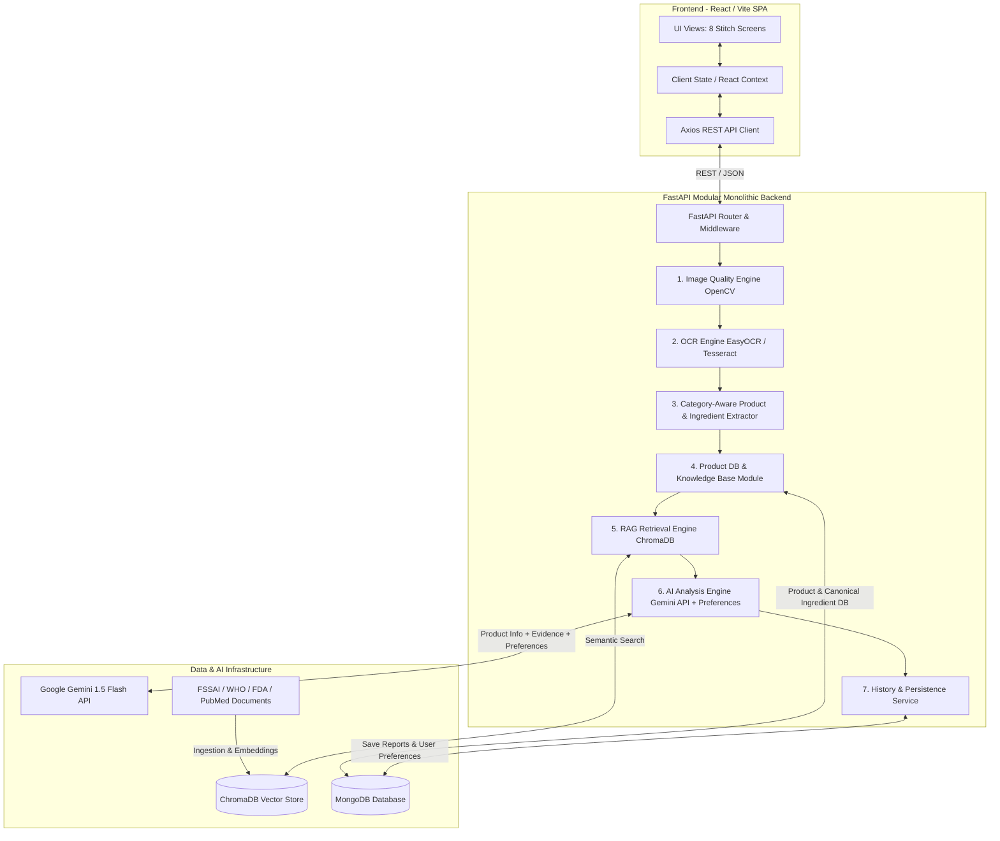
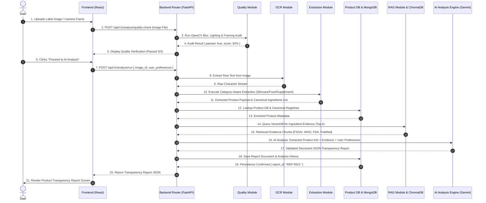

# PARAKH — System Architecture

## Executive Overview
The PARAKH architecture is designed as a **FastAPI Modular Monolithic Backend** paired with a React Single-Page Application (SPA). It cleanly isolates system responsibilities—Image Quality Verification, OCR/Vision, Category-Aware Product & Ingredient Extraction, Database Lookup, RAG Semantic Search, AI Analysis with Personalization, and History Persistence—into cohesive Python modules within a single runnable backend package.

---

## 1. High-Level Architecture Diagram

---

## 2. Component Responsibility Matrix

| Layer / Module | Technology Choice | Core Responsibilities | Scope Status |
| :--- | :--- | :--- | :--- |
| **Frontend SPA** | React 18 + Vite + Tailwind CSS | Renders 8 Stitch UI screens; manages camera stream & file drag-and-drop; maintains client context. | Confirmed Scope |
| **API Gateway & Router** | FastAPI + Pydantic v2 | Modular API routing, request validation, error formatting, CORS middleware. | Confirmed Scope |
| **1. Image Quality Module** | OpenCV + NumPy | Evaluates Laplacian blur variance, brightness histograms, and label framing bounding boxes. | Confirmed Scope |
| **2. OCR Module** | EasyOCR / Tesseract OCR | Extracts raw character strings and bounding boxes from preprocessed label images. | Confirmed Scope |
| **3. Product & Ingredient Extractor** | Python `re` + RapidFuzz | Category-aware text parser (Skincare INCI, Food Additives/FSSAI, Supplements) and canonical dictionary matcher. | Confirmed Scope |
| **4. Product DB & KB Module** | Motor / PyMongo + MongoDB | Lookups for existing verified product records and canonical ingredient master definitions. | Confirmed Scope |
| **5. RAG Retrieval Module** | ChromaDB + SentenceTransformers | Performs vector similarity search over indexed FSSAI, WHO, FDA, and PubMed knowledge chunks. | Confirmed Scope |
| **6. AI Analysis Engine** | Google Gemini API | Synthesizes Extracted Product Info + RAG Evidence + User Preferences into structured JSON reports. | Confirmed Scope |
| **7. History & Persistence** | Motor / PyMongo | Saves user preference profiles, analysis reports, and search history index records. | Confirmed Scope |
| **[Optional] Barcode Lookup** | Open Food Facts / Barcode API | Fallback product search via UPC/EAN barcode. | Optional / Future-Ready |
| **[Optional] PDF Generator** | ReportLab | Exports transparency report to formatted PDF document. | Optional Enhancement |

---

## 3. End-to-End Analysis Sequence Diagram

---

## 4. Key Architectural Guarantees

1. **Modular Monolith Design:** Clean module boundaries inside a single FastAPI application. OCR, RAG, Extraction, and AI modules are separated into distinct services with zero microservice deployment overhead.
2. **Corrected Pipeline Continuity:** OCR text passes strictly into Category-Aware Extraction, which enriches the payload through Product DB lookups before RAG retrieval is queried.
3. **Integrated Personalization:** User preference profiles are submitted directly into the AI Analysis prompt alongside product data and RAG evidence, ensuring personalization insights are synthesized holistically.
